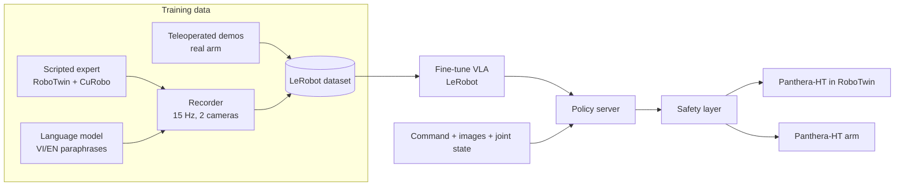

# VLA Robot Sorting

Language-conditioned object sorting on the Panthera-HT robot arm with a small vision-language-action (VLA) model. An operator types a command in Vietnamese or English, such as *"put the red cube in the left tray"*. The model reads camera images, the command and the joint state, and outputs joint targets that pick the named object and place it in the named container.

[](https://github.com/Nguyen-Hao-Khang/vla-robot-sorting/actions/workflows/ci.yml)
[](LICENSE)
[](pyproject.toml)
[](https://github.com/astral-sh/ruff)
[](https://www.conventionalcommits.org)

## Contents

- [Problem](#problem)
- [Objectives](#objectives)
- [Method](#method)
- [Status](#status)
- [Results](#results)
- [Installation](#installation)
- [Reproducing the pipeline](#reproducing-the-pipeline)
- [Repository layout](#repository-layout)
- [Documentation](#documentation)
- [Development](#development)
- [License](#license)

## Problem

| | |
|---|---|
| Input | Wrist-camera and workspace-camera RGB images (320×240), joint positions of the 6-DoF arm and the gripper, a free-form command in Vietnamese or English |
| Output | A chunk of joint-position targets, executed at 15 Hz |
| Task | Pick the object identified by colour and/or shape and place it in the identified container ([task specification](docs/task-spec.md)) |
| Robot | Panthera-HT (HighTorque Robotics), 6 joints, two-finger gripper, 860 mm reach |
| Constraints | Inference on a 6 GB GPU without bf16; 30–50 real demonstrations; Vietnamese is rare in public robot datasets; the real arm must run behind a safety layer |

## Objectives

1. Survey VLA models, the foundation models they build on, and how they map a language command to robot actions.
2. Characterise the hardware: the Panthera-HT arm, its control interface, and the camera setup.
3. Fine-tune a small VLA for object recognition, localisation and pick-and-place from language commands.
4. Integrate the model with the arm into a complete sorting application.
5. Evaluate recognition, language understanding and manipulation reliability, in simulation and on the real arm.

Sorting by semantic category (for example "the edible items") is an extension, attempted only after the attribute-level task works.

## Method



1. **Simulation data.** A scripted expert in RoboTwin picks and places objects on randomised layouts. It plans with CuRobo and reads object poses from the simulator. A recorder samples joint states, joint targets and both camera streams at 15 Hz and keeps successful episodes ([ADR 0003](docs/adr/0003-data-sources.md)).
2. **Commands.** A language model writes several Vietnamese and English phrasings for each (object, container) pair. A separate set of commands written by people serves as the held-out test set.
3. **Fine-tuning.** The team fine-tunes a small VLA with LeRobot. The candidates are SmolVLA and Evo-1 ([ADR 0005](docs/adr/0005-vla-model-selection.md)). ACT, trained on the same data without language, is the baseline.
4. **Deployment.** A policy server runs the checkpoint in the LeRobot environment and answers the simulator or the robot controller over a local socket. Every action passes a safety layer before execution ([ADR 0004](docs/adr/0004-safety-layer.md)).
5. **Real-robot adaptation.** The team records 30–50 teleoperated demonstrations on the real arm and compares training on simulation data, real data, and both.

Details: [architecture](docs/architecture.md), [data and training](docs/data-and-training.md).

## Status

| Component | State |
|---|---|
| Panthera-HT scenes in RoboTwin (7 scene levels) | Working |
| Scripted expert and demonstration recorder | Working; layout randomisation needs extending |
| Conversion to LeRobot format | Working |
| Policy server and simulator client | Implemented; not yet run with a fine-tuned checkpoint |
| Bilingual command generation | Not started |
| VLA model selection | In progress |
| Safety layer | Joint position, velocity, acceleration and jerk checks implemented; workspace box, watchdog and E-stop pending |
| Automated evaluation script | Not started |
| Real robot | Awaiting delivery |

Timeline and milestones: [project plan](docs/project-plan.md).

## Results

No evaluation has been run yet. The experiments below are fixed in advance by the [evaluation protocol](docs/evaluation-protocol.md): at least 30 trials per condition, success rates with Wilson 95% confidence intervals, shared scene seeds across compared conditions.

| ID | Experiment | Conditions | State |
|---|---|---|---|
| E1 | Simulation | Vietnamese vs English; training-set commands vs held-out human-written commands | Pending |
| E2 | Language ablation | Fine-tuned VLA vs ACT on identical scenes | Pending |
| E3 | Real robot | Trained on simulation only, real only, simulation + real | Pending |

Each reported number will link to the commit, configuration, seeds and raw evaluation log that produced it.

## Installation

The repository targets three kinds of machine. [Getting started](docs/getting-started.md) gives the full steps.

| Purpose | Requirements |
|---|---|
| Development and unit tests | Windows, Linux or macOS; Git; [uv](https://docs.astral.sh/uv/) |
| Simulation and data generation | Ubuntu 22.04 on bare metal, NVIDIA GPU with Vulkan, RoboTwin and CuRobo at the revisions in [`configs/repos.lock.yaml`](configs/repos.lock.yaml) |
| Fine-tuning | NVIDIA GPU with 16 GB or more, or a Kaggle T4 session |

Development setup:

```sh
git clone https://github.com/Nguyen-Hao-Khang/vla-robot-sorting.git
cd vla-robot-sorting
uv sync
uv run pytest
```

## Reproducing the pipeline

Run steps 1 and 4 in the RoboTwin conda environment on Ubuntu, steps 2 and 3 in a LeRobot environment.

```sh
# 1. Record scripted demonstrations (headless)
python tools/twin/twin_record.py --out data/twin_raw --episodes 50 --levels 1,2,3 --seed 0

# 2. Convert to a LeRobot dataset
python tools/twin/lerobot_convert.py --raw data/twin_raw --root data/panthera_twin_v1 \
    --repo-id <user>/panthera_twin_v1

# 3. Fine-tune (SmolVLA shown; see notebooks/kaggle_train_panthera_twin.ipynb for ACT)
lerobot-train --dataset.repo_id=<user>/panthera_twin_v1 --dataset.root=data/panthera_twin_v1 \
    --policy.path=lerobot/smolvla_base --policy.empty_cameras=1 \
    --rename_map='{"observation.images.wrist": "observation.images.camera1",
                   "observation.images.workspace": "observation.images.camera2"}' \
    --batch_size=16 --steps=20000 --output_dir=outputs/smolvla

# 4. Serve the checkpoint and run it in the simulator (two terminals)
python tools/twin/policy_bridge.py serve --checkpoint outputs/smolvla/checkpoints/last/pretrained_model \
    --camera-map wrist=camera1,workspace=camera2
python tools/twin/twin_console.py --executor policy --policy-server 127.0.0.1:5555 --level 2
```

Automated evaluation (step 5) arrives with the evaluation script listed in the [project plan](docs/project-plan.md).

## Repository layout

```
vla-robot-sorting/
├── tools/
│   ├── twin/                 Simulation scenes, scripted expert, recorder, LeRobot converter,
│   │                         policy server, interactive console
│   ├── setup/                Host setup and environment checks
│   └── train/                Unattended Kaggle training run
├── src/vla_robot_sorting/
│   ├── contracts/            Data types for joint paths, trajectories and safety reports
│   └── safety/               Safety validators applied before execution
├── configs/                  Camera layout and pinned upstream revisions
├── notebooks/                Kaggle training notebook
├── tests/                    Unit tests (no GPU, simulator or network needed)
├── docs/                     Technical documentation and architecture decisions
└── .github/                  CI, issue forms, Dependabot
```

## Documentation

| Document | Contents |
|---|---|
| [Getting started](docs/getting-started.md) | Development, simulation, training and Kaggle setup |
| [Architecture](docs/architecture.md) | Components, data flow, hardware, known simulator limits |
| [Task specification](docs/task-spec.md) | Scene, objects, commands, success criteria |
| [Data and training](docs/data-and-training.md) | Data sources, formats, dataset versioning, training runs |
| [Evaluation protocol](docs/evaluation-protocol.md) | Metrics, experiment design, statistics, traceability |
| [Architecture decisions](docs/adr/) | Recorded technical decisions with alternatives |
| [Project plan](docs/project-plan.md) | Phases, checkpoints and work items to 31 December 2026 |
| [Contributing](CONTRIBUTING.md) | Branches, commits, pull requests |

## Development

```sh
uv run ruff check .
uv run pytest
uv run pre-commit install   # optional: run the checks on every commit
```

CI runs lint and tests on every pull request and on `main`. A pull request merges only when the `Lint and test` job passes. Unit tests must not need a GPU, the simulator or network access; mark tests that do with `@pytest.mark.simulator` or `@pytest.mark.network`.

The modular pipeline from the first project phase (perception, motion planning, evidence tooling) is preserved at the tag [`sprint1-archive`](https://github.com/Nguyen-Hao-Khang/vla-robot-sorting/tree/sprint1-archive).

## License

[MIT](LICENSE).
