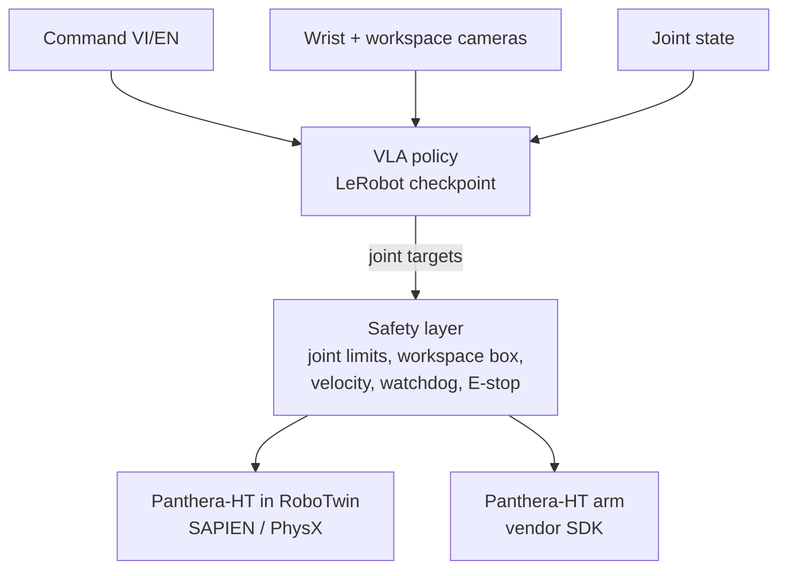

# Architecture

## 1. Problem statement

At each control step $t$ the system receives:

- $I^w_t$, $I^s_t$: RGB images from a wrist camera and a workspace camera, 320×240;
- $q_t \in \mathbb{R}^7$: six arm joint positions and the gripper opening of the Panthera-HT;
- $\ell$: a command in Vietnamese or English, fixed for the episode.

A policy $\pi(a_{t:t+H} \mid I^w_t, I^s_t, q_t, \ell)$ outputs a chunk of $H$ joint-position targets. The episode succeeds when the object named in $\ell$ rests in the container named in $\ell$ ([task specification](task-spec.md)).

Scope: objects are identified by colour and shape. Sorting by semantic category is an extension.

## 2. Components

| Component | Role | Location |
|---|---|---|
| VLA policy | Maps images, command and joint state to joint targets. Model choice in [ADR 0005](adr/0005-vla-model-selection.md) | Trained with LeRobot; `notebooks/` |
| Policy server | Loads a checkpoint in the LeRobot environment and answers action requests over a local socket | `tools/twin/policy_bridge.py` |
| Safety layer | Rejects actions outside joint, velocity, acceleration and jerk limits; workspace box, watchdog and E-stop to be added ([ADR 0004](adr/0004-safety-layer.md)) | `src/vla_robot_sorting/safety/` |
| Simulation scenes | Panthera-HT with a table, objects and containers; seven scene levels | `tools/twin/twin_scene.py`, `twin_assets.py`, `twin_cameras.py` |
| Scripted expert | Executes pick-and-place with CuRobo motion planning and simulator ground truth; generates demonstrations | `tools/twin/twin_console.py`, `twin_grasp.py`, `twin_kinematics.py`, `twin_obstacles.py` |
| Recorder | Samples joint states, joint targets and camera frames while the expert acts | `tools/twin/twin_record.py` |
| Dataset converter | Converts raw episodes to the LeRobot dataset format | `tools/twin/lerobot_convert.py` |
| Interactive console | Accepts typed commands, plans them with a language model, executes them with the expert or a policy | `tools/twin/twin_console.py`, `twin_models.py` |

## 3. Data flow

### 3.1 Training

1. `twin_record.py` samples a scene layout and a task. The scripted expert executes it. The recorder stores joint states, the next joint state as the action, and both camera streams at 15 Hz. It keeps successful episodes only.
2. A language model writes Vietnamese and English phrasings for each task.
3. `lerobot_convert.py` writes a versioned LeRobot dataset, stored on the Hugging Face Hub or Kaggle.
4. LeRobot fine-tunes the policy on a GPU with 16 GB or more.
5. With the real arm available, the team records teleoperated demonstrations and trains on the combined data.

Details: [data and training](data-and-training.md).

### 3.2 Inference

1. `policy_bridge.py serve` loads the checkpoint and listens on `127.0.0.1:5555`.
2. The simulator or robot controller sends the joint state, camera frames and command. Each message is a 4-byte length prefix followed by JSON.
3. The server returns joint targets. The safety layer checks them before execution.

The policy and the simulator run in separate Python environments (LeRobot and RoboTwin) because their dependencies conflict. The socket boundary matches how the real robot will receive commands from the control PC.

## 4. Hardware

| Machine | Configuration | Role |
|---|---|---|
| Simulation workstation | GTX 1660 Ti 6 GB, Ubuntu 22.04 | RoboTwin, demonstration recording, simulated evaluation, real-robot control |
| Training workstation | RTX 5090, Windows | Fine-tuning |
| Cloud GPU | Kaggle T4 16 GB | Fine-tuning |
| Robot | Panthera-HT, 6 joints + two-finger gripper, 860 mm reach, 3.5 kg payload | Real-robot experiments |

The GTX 1660 Ti has no hardware bf16, so inference runs in fp16 or fp32.

## 5. Known simulator limits

- **Reach with a vertical gripper.** With the gripper pointing straight down the tool rises only to 0.86–0.92 m in the world frame; tilted by 35–45° it rises to 1.07–1.10 m. The expert chooses a tilted grasp when needed (`twin_kinematics.py`). `tools/twin/twin_workspace_plot.py` regenerates the reach maps.
- **Collision world.** RoboTwin passes only the table to CuRobo. `twin_obstacles.py` adds the objects on the table.
- **Graspability.** The two-finger gripper cannot hold a tetrahedron reliably, so the task specification excludes it.
